# Adapter Landscape — Sentinel_Hub

**Status:** Active  
**Scope:** Public adapters only. Input layer (Table A). No sealed processing.  
**Badge Required:** PRISM

---

## Purpose

This document catalogs all adapters that bring external data into Sentinel_Hub.

It answers: "What adapters exist, what do they ingest, and where does their output go?"

---

## What Adapters Do

Adapters are the **intake valves** of Table A. They:

1. Connect to external data sources
2. Normalize raw data into standard format
3. Pass normalized data to the Hallway boundary
4. That's it — no processing, no decisions

```mermaid
flowchart LR
    subgraph EXTERNAL [External Sources]
        E1[APIs]
        E2[Feeds]
        E3[Files]
        E4[Streams]
    end

    subgraph TABLE_A [Table A — Adapters]
        A1[VentAdapter]
        A2[MarketAdapter]
        A3[TextAdapter]
        A4[GridAdapter]
        A5[BioAdapter]
    end

    subgraph HALLWAY [Hallway]
        H1[/// Boundary ///]
    end

    E1 --> A1
    E1 --> A2
    E2 --> A3
    E3 --> A4
    E4 --> A5

    A1 --> H1
    A2 --> H1
    A3 --> H1
    A4 --> H1
    A5 --> H1

    style HALLWAY fill:#1a1a1a,stroke:#ff4444,stroke-width:2px
    style H1 fill:#1a1a1a,color:#ff4444
```


---

## Adapter Registry

| Adapter | Purpose | Input Source | Status |
|---------|---------|--------------|--------|
| `VentAdapter` | Social sentiment, public discourse | Social APIs, RSS | Active |
| `MarketAdapter` | Financial market data | Exchange APIs, data vendors | Active |
| `TextAdapter` | Unstructured text, documents | File uploads, webhooks | Active |
| `GridAdapter` | Energy grid telemetry | Utility APIs, SCADA feeds | Prototype |
| `BioAdapter` | Biological/health signals | Lab APIs, device streams | Prototype |

---

## Adapter Details

### VentAdapter

**Purpose:** Ingest public sentiment and discourse signals.

| Field | Value |
|-------|-------|
| Status | Active |
| Location | `/src/adapters/vent/` |
| Input | Social APIs, RSS feeds, public forums |
| Output Schema | `NormalizedSentiment` |
| Rate | Configurable polling / webhook |

**Output to Hallway:**
```json
{
  "adapter": "vent",
  "timestamp": "2025-11-24T12:00:00Z",
  "schema": "NormalizedSentiment",
  "payload": {
    "source": "twitter",
    "volume": 15000,
    "sentiment_raw": { ... }
  }
}
```

**Does NOT do:**
- Sentiment scoring (sealed)
- Signal extraction (sealed)
- Any interpretation (sealed)

---

### MarketAdapter

**Purpose:** Ingest financial market data.

| Field | Value |
|-------|-------|
| Status | Active |
| Location | `/src/adapters/market/` |
| Input | Exchange APIs, data vendors (Alpaca, Binance, etc.) |
| Output Schema | `NormalizedMarket` |
| Rate | Real-time WebSocket / REST polling |

**Output to Hallway:**
```json
{
  "adapter": "market",
  "timestamp": "2025-11-24T12:00:00Z",
  "schema": "NormalizedMarket",
  "payload": {
    "symbol": "BTC/USD",
    "price": 97500.00,
    "volume_24h": 1200000000,
    "ohlcv": { ... }
  }
}
```

**Does NOT do:**
- Price prediction (sealed)
- Signal generation (sealed)
- Any analysis (sealed)

---

### TextAdapter

**Purpose:** Ingest unstructured text and documents.

| Field | Value |
|-------|-------|
| Status | Active |
| Location | `/src/adapters/text/` |
| Input | File uploads, webhooks, document APIs |
| Output Schema | `NormalizedText` |
| Rate | On-demand / batch |

**Output to Hallway:**
```json
{
  "adapter": "text",
  "timestamp": "2025-11-24T12:00:00Z",
  "schema": "NormalizedText",
  "payload": {
    "source": "upload",
    "doc_type": "pdf",
    "content_raw": "...",
    "metadata": { ... }
  }
}
```

**Does NOT do:**
- Entity extraction (sealed)
- Semantic analysis (sealed)
- Any interpretation (sealed)

---

### GridAdapter

**Purpose:** Ingest energy grid telemetry.

| Field | Value |
|-------|-------|
| Status | Prototype |
| Location | `/src/adapters/grid/` |
| Input | Utility APIs, SCADA feeds, ISO data |
| Output Schema | `NormalizedGrid` |
| Rate | Polling (1-5 min intervals) |

**Output to Hallway:**
```json
{
  "adapter": "grid",
  "timestamp": "2025-11-24T12:00:00Z",
  "schema": "NormalizedGrid",
  "payload": {
    "region": "CAISO",
    "load_mw": 28500,
    "generation_mix": { ... },
    "frequency_hz": 60.01
  }
}
```

**Does NOT do:**
- Load forecasting (sealed)
- Anomaly detection (sealed)
- Any prediction (sealed)

---

### BioAdapter

**Purpose:** Ingest biological and health signals.

| Field | Value |
|-------|-------|
| Status | Prototype |
| Location | `/src/adapters/bio/` |
| Input | Lab APIs, device streams, health records |
| Output Schema | `NormalizedBio` |
| Rate | Event-driven / batch |

**Output to Hallway:**
```json
{
  "adapter": "bio",
  "timestamp": "2025-11-24T12:00:00Z",
  "schema": "NormalizedBio",
  "payload": {
    "source": "lab_device",
    "signal_type": "spectral",
    "readings": { ... }
  }
}
```

**Does NOT do:**
- Diagnostic inference (sealed)
- Pattern recognition (sealed)
- Any interpretation (sealed)

---

## Standard Output Schema

All adapters output to the Hallway using this envelope:
```json
{
  "adapter": "string — adapter name",
  "timestamp": "ISO 8601 — when data was captured",
  "schema": "string — payload schema name",
  "payload": { }
}
```

The Hallway accepts this envelope. What happens after is sealed.

---

## Adapter Lifecycle

| Status | Meaning |
|--------|---------|
| **Active** | Production-ready, in use |
| **Prototype** | In development, limited testing |
| **Deprecated** | Being phased out, don't build on it |
| **Planned** | On roadmap, not started |

---

## Adding a New Adapter

1. Create folder in `/src/adapters/{name}/`
2. Implement standard output schema
3. Add row to this registry
4. Document in this file with full detail block
5. Test against Hallway boundary (accepts valid envelope)
6. Update status from Prototype → Active when ready

**Badge required:** PRISM for implementation, STEWARD to update this catalog.

---

## What This Document Does NOT Cover

- What happens after data enters the Hallway (sealed)
- How adapters are selected or prioritized (sealed)
- Internal routing logic (sealed)
- Any processing beyond normalization (sealed)

**Rule:** Adapters intake. They don't think.

---

## Reference

- `DATA_FLOW_OVERVIEW.md` — How data moves through public layers
- `PUBLIC_INTERFACE_CATALOG.md` — API endpoints that trigger adapters
- `FOLDER_PURPOSE_MATRIX.md` — Where adapter code lives
- `/src/adapters/` — Actual adapter implementations

---

Last updated: November 24, 2025  
Maintained by: Founder + STEWARD  
Status: Ready for architecture review
